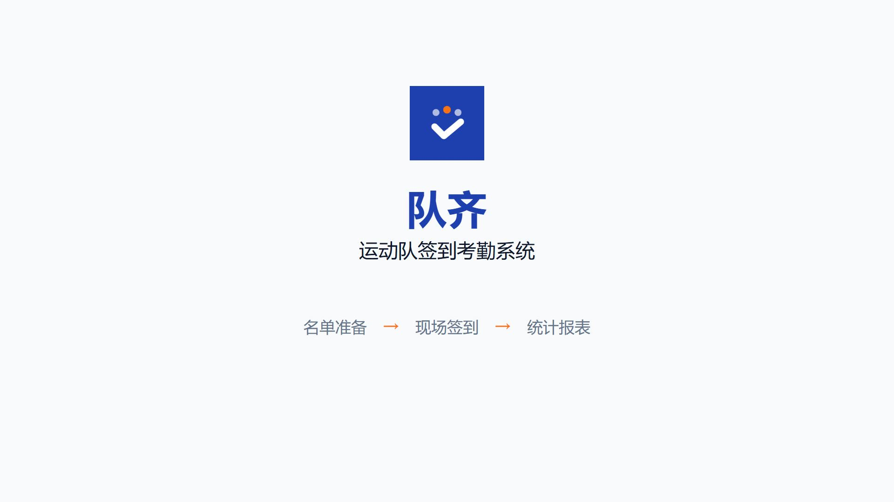
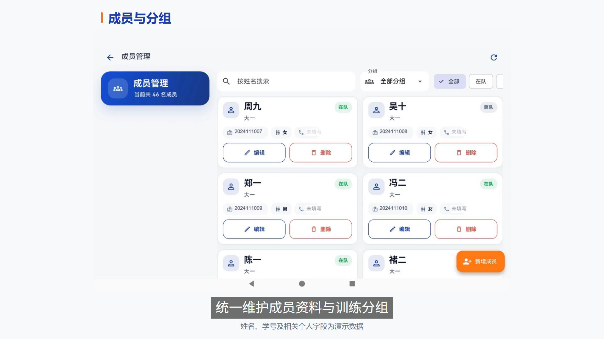
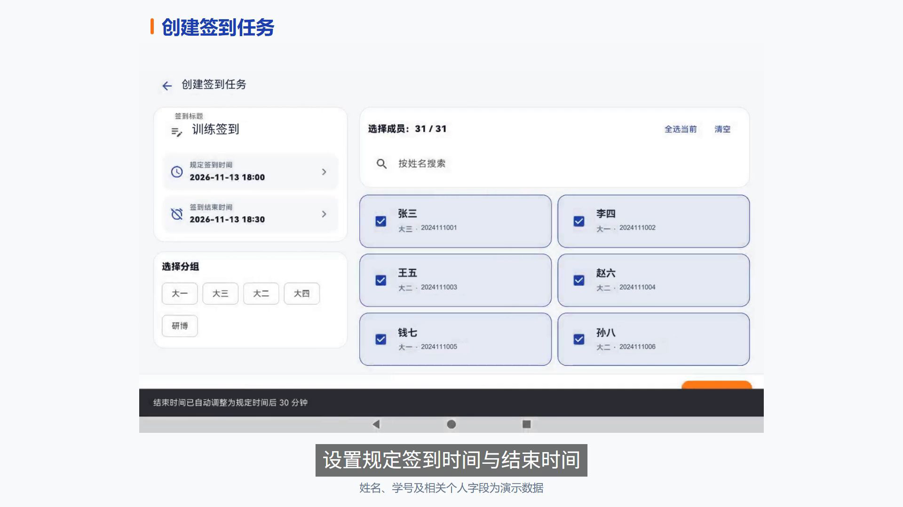
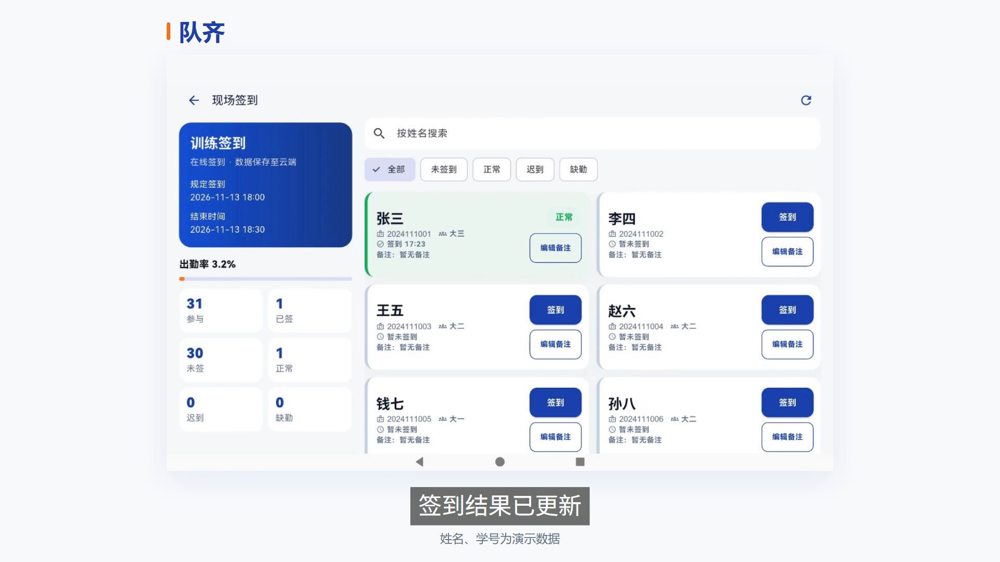
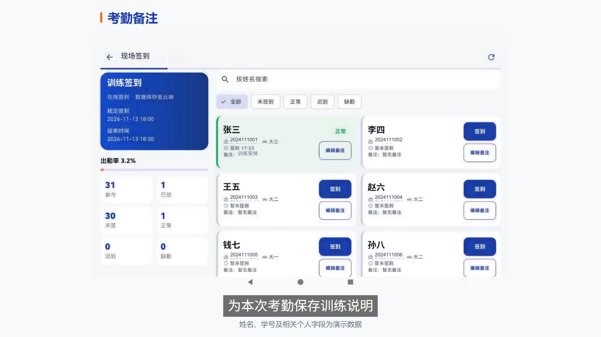
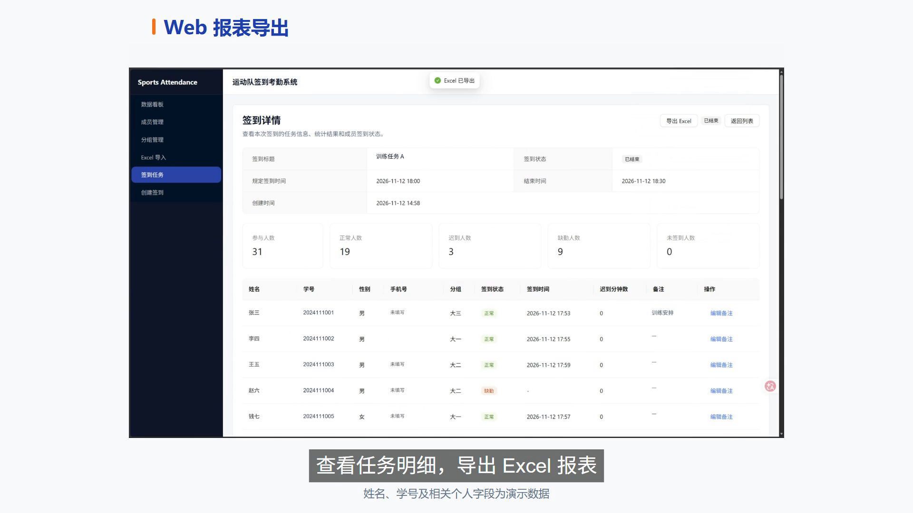
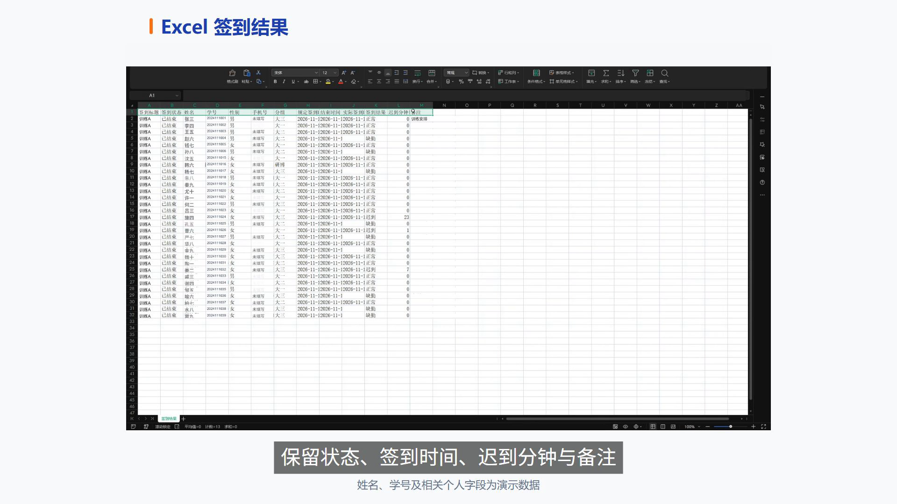
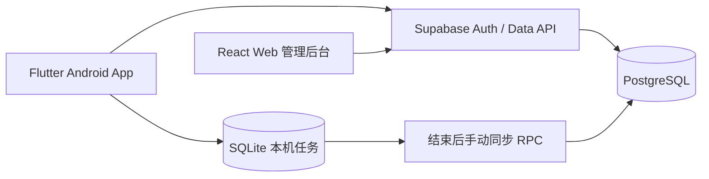

# 队齐 · 运动队签到考勤系统

面向校队日常训练的考勤工具，将名单准备、现场签到和训练后汇总连接起来。包含 **Flutter Android App、React Web 管理后台、SQLite 离线记录与 Excel 报表**。

项目已用于校队日常考勤，持续支持训练签到与统计汇总。

本项目在 AI 辅助下开发完成。

2026.06—至今 · 校队实际使用

## 项目介绍视频

[](https://gx221015cf.github.io/sports-attendance-system/showcase/)

**[▶ 在线播放第一版完整介绍视频](https://gx221015cf.github.io/sports-attendance-system/showcase/)** · [直接打开 MP4](https://gx221015cf.github.io/sports-attendance-system/showcase/demo.mp4) · [仓库原文件下载](https://raw.githubusercontent.com/GX221015CF/sports-attendance-system/master/docs/showcase/demo.mp4) · [镜头与素材说明](docs/showcase/README.md)

第一版 Remotion 完整初剪，约 62 秒，1080p / 30fps。视频展示成员管理、创建任务、现场签到、备注、结束结算、Web 与单任务 Excel。画面中的姓名、学号和相关个人字段使用演示映射。结束段切换到另一训练任务，Web 展示历史任务，具体语境见镜头说明。

## 业务背景与实际使用

### 业务背景

校队训练需要维护分组与名单、记录到场时间、判断迟到缺勤，并在期末整理考勤。纸质记录与后续汇总之间存在重复整理工作，因此项目围绕训练前、训练中和训练后的连续流程建设。

### 实际使用成果

名单导入、签到、迟到缺勤、离线同步和 Excel 报表形成了连续的考勤管理流程，历史测试与设备验收记录见下方验证说明。

## 核心功能与业务流程

| 环节 | 已实现能力 |
| --- | --- |
| 名单准备 | 成员与分组维护、搜索筛选、Excel 导入预览与基础校验 |
| 任务发布 | 设置规定时间和结束时间，按分组或成员选择参与名单 |
| 现场签到 | 拼音排序、搜索、状态筛选、单击提交、保存中防重复、失败重试 |
| 状态判断 | `pending` 未签到、`normal` 正常、`late` 迟到、`absent` 缺勤，记录实际时间与迟到分钟 |
| 备注与结算 | 自由文本备注、手动结束，以及页面发现过期后的结束处理 |
| 统计报表 | 人数与出勤率、单任务 Excel、多任务人员汇总和任务明细 |
| 离线使用 | 提前准备名单，在 SQLite 创建和完成本机新任务，结束后手动同步 |
| 设备体验 | 平板横屏分区、惰性名单、键盘和表单适配、真实保存后的视觉与声音反馈 |

```text
成员与分组 / Excel 名单
    → 创建任务、选择成员与时间
    → 现场签到、备注
    → 结束结算、缺勤判断
    → 出勤统计、Excel 导出
```

### 离线签到与手动同步

视频聚焦在线业务。项目另有完整的显式离线流程。

```text
联网准备名单
    → 本机新建任务
    → SQLite 保存签到、备注与结束结果
    → 管理员联网后点击手动同步
    → Web 查看与导出
```

本地记录支持重启后读取。同步失败保留结果，稳定任务 ID、上传快照锁定、内容校验和服务端事务回执支持重试。网络恢复后，任务等待管理员显式发起同步。使用条件与数据边界见 [离线模式说明](docs/OFFLINE_MODE.md)。

### 时间与统计口径

- 保存时刻不晚于规定时间，记为正常。
- 晚于规定时间且不晚于结束时间，记为迟到。分钟差向下取整，最小为 1 分钟。
- 超过结束时间后禁止签到。手动结束或页面检查发现过期时，剩余未签到记录结算为缺勤。
- 出勤率为 `(正常 + 迟到) / 应签到`。
- 备注独立保存在当次考勤记录中，支持编辑与清空。

## 代表截图

以下截图均直接取自上方 full-v1 成片，使用同版演示身份和镜头语境。点击图片可查看原尺寸。

| 成员管理 | 创建签到任务 |
| --- | --- |
| [](docs/showcase/images/members.png) | [](docs/showcase/images/creation.png) |
| 维护名单、分组与成员状态 | 选择参与成员并设置规定与结束时间 |

| 现场签到 | 考勤备注 |
| --- | --- |
| [](docs/showcase/images/checkin.png) | [](docs/showcase/images/remark.png) |
| 单击保存后更新状态与人数 | 为当次记录保存训练说明 |

| Web 管理后台 | Excel 签到结果 |
| --- | --- |
| [](docs/showcase/images/web.png) | [](docs/showcase/images/excel.png) |
| 历史任务详情与导出 | 单任务“签到结果”工作表 |

## 系统架构与技术栈



| 模块 | 技术与职责 | 目录 |
| --- | --- | --- |
| 移动端 | Flutter、Dart、supabase_flutter、sqflite、uuid、intl、lpinyin | [mobile_app](mobile_app/) |
| Web 后台 | React、TypeScript、Vite、Ant Design、xlsx、dayjs | [admin_web](admin_web/) |
| 云端数据 | Supabase PostgreSQL、Auth、SQL RPC、RLS | [database](database/)、[supabase](supabase/) |
| 原生声音 | Kotlin、平台通道、SoundPool、SharedPreferences | [Android 实现](mobile_app/android/app/src/main/kotlin/com/example/mobile_app/) |
| 视频展示 | Remotion 成片、同版抽帧与媒体清单 | [showcase](docs/showcase/) |

核心数据为 `groups`、`members`、`attendance_sessions`、`session_members`。同一任务与成员组合唯一，迟到分钟具备非负约束，备注通过独立迁移增加。详细契约见 [项目上下文](docs/PROJECT_CONTEXT.md)。

## 配置、运行与验证

准备兼容项目依赖的 Node.js / npm、Flutter SDK、Android SDK，以及自己的 Supabase 开发项目。Dart SDK 约束见 [pubspec.yaml](mobile_app/pubspec.yaml)，Web 依赖见 [package.json](admin_web/package.json)。

### 数据库准备

在自己的开发环境依次应用核心表、备注和离线同步迁移，并配置适合该环境的访问策略。

```text
database/schema.sql
database/add_session_member_remark.sql
supabase/migrations/20261009185846_offline_attendance_sync.sql
```

[dev_rls_policies.sql](database/dev_rls_policies.sql) 为受控开发验证使用的宽松策略。生产环境需要按角色和业务范围配置授权。详细步骤见 [运行手册](docs/RUNBOOK.md)与[离线说明](docs/OFFLINE_MODE.md)。

### Web 后台

```powershell
cd admin_web
npm ci
Copy-Item .env.example .env
# 在本机填写自己的前端公开客户端配置
npm run dev
```

### Flutter App

```powershell
cd mobile_app
flutter pub get
Copy-Item .env.example .env
# 在本机填写自己的前端公开客户端配置
flutter run -d DEVICE_ID --dart-define-from-file=.env
```

构建、Android 依赖和安装步骤见 [运行手册](docs/RUNBOOK.md)。真实配置保存于本地被忽略的文件，前端配置使用 publishable／兼容 anon key，服务端密钥保存在服务端安全环境。

### 检查入口

```powershell
# 在 admin_web 目录
npm run lint
npm run build

# 在 mobile_app 目录
flutter analyze
flutter test

# 在项目根目录
git diff --check
```

现有 Flutter 测试覆盖时间边界、SQLite、同步异常、横屏、键盘、表单、动效与音效。2026 年 10 月 25 日 v2 验收记录包含完整 133 项测试通过和平板体验验收。500 人合成名单回归的视口条件、挂载数量及设备反馈见 [交互进展](docs/INTERACTION_PROGRESS.md)和[v2 验收存档](docs/versions/duiqi-ux-audio-v2-20261025.md)。这些数据均保留其历史日期与验证范围。

## 当前实现边界与后续改进

- **授权。** App 有邮箱密码登录，Web 当前直接使用数据客户端。生产级管理员授权和核心表 RLS 仍需完善，登录身份与业务操作权限需要独立设计。
- **历史留存。** 当前删除成员或任务会级联删除对应考勤。长期使用需要结合停用、归档与备份策略完善历史保留。
- **离线条件。** 离线创建本机新任务，使用提前准备的名单和设备时钟。当前支持结束后整单手动同步，本地备份、跨设备搬迁与更完整的时间可信性仍可继续建设。
- **发布配置。** 队齐名称与图标已接入。正式签名、隐私说明、多设备验证和数据备份属于后续发布准备。
- **持续验证。** 后续结合真实训练流程继续回归，并补充 Web 自动化与可复核的业务指标。

## 资料索引与素材来源

| 资料 | 内容 |
| --- | --- |
| [展示说明](docs/showcase/README.md) | 第一版视频、镜头语境、代表帧和媒体参数 |
| [素材与许可状态](docs/showcase/ASSET_SOURCES.md) | 项目素材、依赖、声音来源及当前许可范围 |
| [产品需求](docs/PRD.md) | 初版角色、MVP 与业务规则 |
| [项目上下文](docs/PROJECT_CONTEXT.md) | 当前数据契约、功能与迭代依据 |
| [运行手册](docs/RUNBOOK.md) | 数据库、Web、Flutter 与构建 |
| [离线模式](docs/OFFLINE_MODE.md) | 名单准备、本机任务、同步与失败处理 |
| [QA 清单](docs/QA_CHECKLIST.md) | 人工业务检查入口 |
| [交互迭代](docs/INTERACTION_PROGRESS.md) | 横屏、键盘、长名单及体验验证 |
| [音效说明](docs/INTERACTION_AUDIO.md) | 声音映射、保存时机与平台实现 |
| [v2 验收记录](docs/versions/duiqi-ux-audio-v2-20261025.md) | 已验收应用源码与历史测试证据 |

当前未配置通用开源许可证。第三方依赖及参考素材各自适用其来源与许可，相关状态见素材说明。
