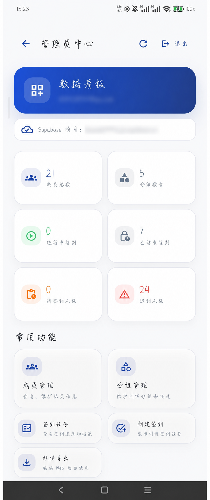
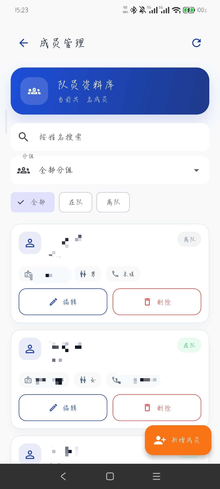
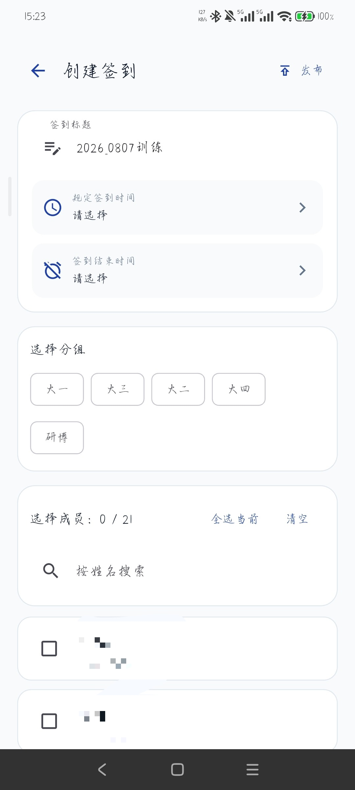
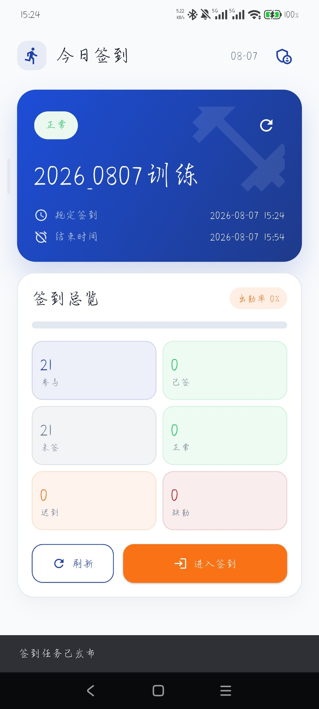
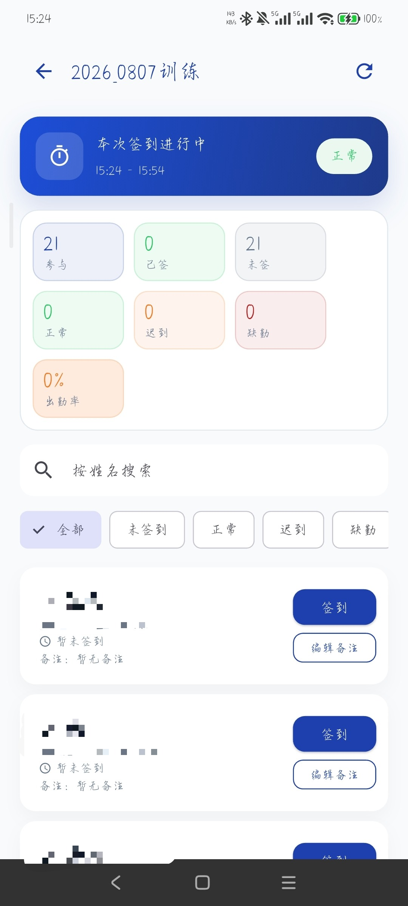
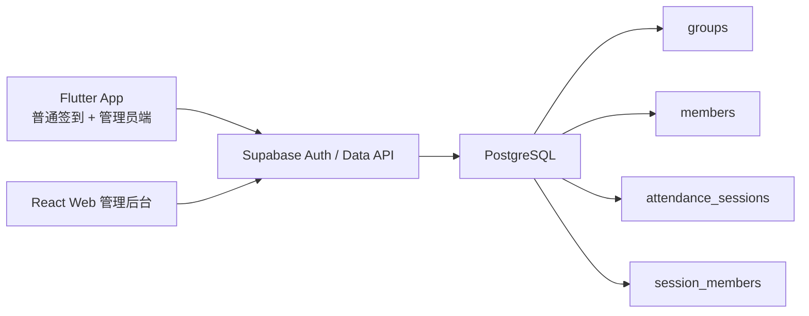

# 运动队签到考勤系统

一个面向校队、社团和训练小组的签到考勤系统，包含 Flutter 移动端、React Web 管理后台、Supabase PostgreSQL 数据库脚本，以及配套的产品、运行和测试文档。

当前版本为可运行的 MVP，覆盖成员与分组管理、签到任务创建、现场签到、迟到/缺勤判定、备注、统计和 Excel 导出。

## 功能概览

### Flutter App

- 展示当前进行中的签到任务
- 按姓名拼音排序、搜索和状态筛选成员
- 点击成员确认签到
- 自动判断正常、迟到和迟到分钟数
- 超过结束时间后关闭签到并将未签到成员标记为缺勤
- 为任意签到状态添加或清空自由文本备注
- 管理员邮箱密码登录（Supabase Auth）
- App 内管理成员、分组和签到任务
- 管理员数据看板和签到详情
- 竖屏、横屏和大屏布局适配

### Web 管理后台

- 数据看板
- 成员新增、编辑、删除、筛选
- 分组新增、编辑、删除
- Excel 批量导入成员
- 创建、编辑、删除和结束签到任务
- 查看签到详情并编辑成员备注
- 单次签到 Excel 导出
- 多次签到合并统计与批量 Excel 导出

## 界面预览

<table>
  <tr>
    <td align="center" width="33%">
      <br>
      <sub>管理员数据看板</sub>
    </td>
    <td align="center" width="33%">
      <br>
      <sub>成员管理</sub>
    </td>
    <td align="center" width="33%">
      <br>
      <sub>创建签到</sub>
    </td>
  </tr>
  <tr>
    <td align="center" width="33%">
      <br>
      <sub>今日签到</sub>
    </td>
    <td align="center" width="33%">
      <br>
      <sub>成员签到列表</sub>
    </td>
    <td width="33%"></td>
  </tr>
</table>

> 截图中的账号、Supabase 项目标识及成员个人信息均已脱敏。

## 系统架构



| 模块 | 技术栈 | 目录 |
| --- | --- | --- |
| 移动端 | Flutter、Dart、supabase_flutter、intl、lpinyin | `mobile_app/` |
| Web 后台 | React、Vite、TypeScript、Ant Design、xlsx | `admin_web/` |
| 数据库 | Supabase PostgreSQL、RLS | `database/` |
| 产品与运维文档 | Markdown | `docs/` |
| UI 参考 | Stitch / Figma 导出图 | `design/stitch-ui/` |

## 目录结构

```text
sports-attendance-system/
├── admin_web/                 # React Web 管理后台
├── mobile_app/                # Flutter 多平台工程，主要目标为 Android
├── database/
│   ├── schema.sql             # 四张核心表、约束和索引
│   ├── add_session_member_remark.sql
│   └── dev_rls_policies.sql   # 仅用于开发阶段的宽松 RLS
├── docs/
│   ├── PRD.md
│   ├── PROJECT_CONTEXT.md
│   ├── QA_CHECKLIST.md
│   ├── RUNBOOK.md
│   └── START_ADMIN_WEB.md
├── design/stitch-ui/          # UI 参考图
├── scripts/                   # 预留脚本目录
└── 启动电脑后台.bat           # Windows Web 后台启动脚本
```

## 数据模型

| 表 | 用途 | 关键字段 |
| --- | --- | --- |
| `groups` | 训练分组 | `name`、`description` |
| `members` | 队员资料 | `name`、`student_id`、`group_id`、`is_active` |
| `attendance_sessions` | 签到任务 | `required_time`、`end_time`、`status` |
| `session_members` | 每次任务中的成员考勤记录 | `status`、`checkin_time`、`late_minutes`、`remark` |

签到状态：

- `pending`：未签到
- `normal`：正常
- `late`：迟到
- `absent`：缺勤

时间判定规则：

```text
当前时间 <= required_time              -> normal
required_time < 当前时间 <= end_time   -> late
当前时间 > end_time 且仍未签到          -> absent
```

备注保存在 `session_members.remark`。更新备注不会修改签到状态、签到时间或迟到分钟数。

## 环境要求

- Node.js 20 或更高版本
- npm
- Flutter SDK（项目当前 Dart SDK 约束见 `mobile_app/pubspec.yaml`）
- Android Studio / Android SDK（真机或模拟器运行时）
- 一个 Supabase 项目

可用以下命令检查本地环境：

```powershell
node --version
npm --version
flutter doctor
flutter devices
```

## 1. 配置 Supabase

1. 在 Supabase 控制台创建项目。
2. 在 SQL Editor 中依次执行：

   ```text
   database/schema.sql
   database/add_session_member_remark.sql
   database/dev_rls_policies.sql
   ```

3. 在 Authentication 中创建管理员邮箱密码账号，供 Flutter 管理员端登录。
4. 确认以下表已创建：`groups`、`members`、`attendance_sessions`、`session_members`。

`database/dev_rls_policies.sql` 会给 `anon` 和 `authenticated` 开发角色开放四张表的读写权限。它只适合本地开发和 MVP 验证，生产部署前必须替换成按管理员身份和业务范围授权的严格策略。

## 2. 启动 Web 管理后台

进入 Web 目录并安装依赖：

```powershell
cd admin_web
npm install
```

复制环境变量示例：

```powershell
Copy-Item .env.example .env
```

在 `admin_web/.env` 中填写自己的前端可用配置：

```dotenv
VITE_SUPABASE_URL=https://YOUR_PROJECT_REF.supabase.co
VITE_SUPABASE_ANON_KEY=YOUR_PUBLISHABLE_OR_ANON_KEY
```

启动开发服务器：

```powershell
npm run dev
```

默认访问地址通常是 <http://localhost:5173>。也可以在项目根目录双击 `启动电脑后台.bat`。

生产构建检查：

```powershell
npm run build
```

## 3. 运行 Flutter App

安装依赖：

```powershell
cd mobile_app
flutter pub get
```

复制环境变量示例并填写自己的配置：

```powershell
Copy-Item .env.example .env
```

```dotenv
SUPABASE_URL=https://YOUR_PROJECT_REF.supabase.co
SUPABASE_ANON_KEY=YOUR_PUBLISHABLE_OR_ANON_KEY
```

运行到已连接设备：

```powershell
flutter run -d DEVICE_ID --dart-define-from-file=.env
```

也可以显式传入变量，但不建议在共享终端或脚本中留下真实值：

```powershell
flutter run -d DEVICE_ID `
  --dart-define=SUPABASE_URL=YOUR_SUPABASE_URL `
  --dart-define=SUPABASE_ANON_KEY=YOUR_PUBLISHABLE_OR_ANON_KEY
```

## 4. 构建 Android APK

Debug APK：

```powershell
cd mobile_app
flutter build apk --debug --dart-define-from-file=.env
```

Release APK：

```powershell
flutter build apk --release --dart-define-from-file=.env
```

输出位置：

```text
mobile_app/build/app/outputs/flutter-apk/app-debug.apk
mobile_app/build/app/outputs/flutter-apk/app-release.apk
```

仓库不会提交 `.apk`、`.aab`、`build/` 或本地环境变量文件。

## Excel 导入与导出

Web 后台支持成员名单 Excel 导入，以及单次/批量签到导出。批量导出包含：

- 人员汇总 Sheet
- 签到总览 Sheet
- 每次签到的状态、时间、迟到分钟和备注动态列
- 正常、迟到、缺勤、未签到次数及出勤率

出勤率计算：

```text
(normal + late) / 应签到次数 * 100%
```

## 验证与测试

Web：

```powershell
cd admin_web
npm run lint
npm run build
```

Flutter：

```powershell
cd mobile_app
dart format --output=none --set-exit-if-changed lib test
flutter analyze
flutter test
```

完整人工验收项见 [docs/QA_CHECKLIST.md](docs/QA_CHECKLIST.md)。重点验证创建签到、正常/迟到判定、结束签到、缺勤标记、备注、Excel 导入导出和横屏布局。

## 安全说明

- 不要提交 `.env`、数据库密码、JWT、`service_role` 或 Supabase secret key。
- Flutter 和 Web 前端只能使用 publishable key 或兼容用的 anon key，权限必须由 RLS 控制。
- 当前 Web 后台直接使用前端 Supabase 客户端，尚未实现独立的 Web 登录和严格管理员授权。
- `dev_rls_policies.sql` 是开发策略，不是生产安全策略；直接用于公网会让客户端拥有过宽的数据修改权限。
- 正式部署前应收紧 RLS、补充管理员授权模型、配置正式 Android 签名，并执行真实训练场景回归测试。

仓库已通过常见密钥模式扫描；`.env`、构建产物和安装包由 `.gitignore` 排除。示例环境文件只包含变量名和占位值。

## 文档索引

- [产品需求文档](docs/PRD.md)
- [项目上下文](docs/PROJECT_CONTEXT.md)
- [运行手册](docs/RUNBOOK.md)
- [QA 检查清单](docs/QA_CHECKLIST.md)
- [Windows 后台启动说明](docs/START_ADMIN_WEB.md)
- [Codex 开发任务清单](docs/CODEX_TASKS.md)

## 当前状态与后续重点

当前 MVP 已可运行，手机端和 Web 端通过同一个 Supabase 项目同步数据。后续优先级：

1. 收紧生产环境 RLS 和管理员权限模型。
2. 补充 Web 管理员登录与访问控制。
3. 配置正式应用名称、图标和 Android 发布签名。
4. 增加自动化测试和真实训练场景回归测试。
