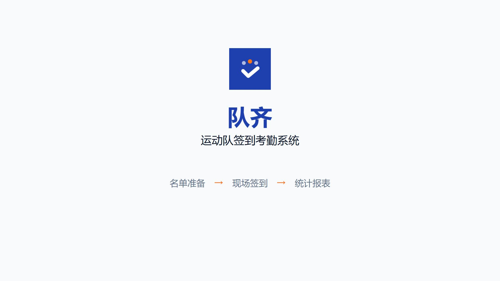

# 队齐 · 第一版项目介绍视频

**[▶ 在线播放](https://gx221015cf.github.io/sports-attendance-system/showcase/)** · [直接打开 MP4](https://gx221015cf.github.io/sports-attendance-system/showcase/demo.mp4) · [仓库原文件下载](https://raw.githubusercontent.com/GX221015CF/sports-attendance-system/master/docs/showcase/demo.mp4) · [返回项目介绍](../../README.md)

## 展示版本

本目录采用用户选定的 **Remotion 第一版完整初剪 full-v1**。视频按原字节复制，封面及六张代表截图均从该成片提取。应用源码以已验收的 `duiqi-ux-audio-v2-20261025` 为整合基线。

GitHub Pages 播放页使用原生视频控件，支持播放、进度与音量操作。仓库 MP4 文件页受 GitHub 二进制预览限制，视频原文件同时保留下载入口。

| 项目 | 数值 |
| --- | --- |
| 文件 | [demo.mp4](demo.mp4) |
| 原文件名 | `duiqi-full-intro-first-cut-v1.mp4` |
| 大小 | 5,762,431 字节，约 5.76 MB |
| 容器时长 | 62.016 秒 |
| 视频时间线 | 62.000 秒，1860 帧 |
| 分辨率与帧率 | 1920×1080，30fps |
| 编码 | H.264 视频，AAC 音频，48 kHz 双声道 |
| SHA256 | `9faf6aa26f5b79acb637c9f74d3e9bc55ec15ff3189799db3087358ccf45fdb2` |

AAC 封装带来 16ms 容器尾差。文件、截图时间点和指纹见 [媒体清单](media-manifest.json)。

## 镜头与业务语境

| 成片时间 | 镜头 | 说明 |
| --- | --- | --- |
| 0—5 秒 | 队齐品牌与定位 | 名单准备、现场签到、统计报表 |
| 5—12 秒 | 成员与分组 | 管理成员资料、分组及成员状态 |
| 12—23 秒 | 创建签到任务 | 呈现已选参与名单、已设置时间、发布与返回管理页 |
| 23—29.5 秒 | 现场签到 | 单击签到、保存结果与原始交互音效 |
| 29.5—34 秒 | 备注 | 为演示成员保存“训练安排” |
| 34—39.5 秒 | 结束另一训练任务 | 视频字幕明确任务切换，保留其实际结束操作 |
| 39.5—43 秒 | 结束统计 | 该任务已签 1 人，为迟到，缺勤 30 人 |
| 43—50 秒 | Web 历史任务与导出 | 独立历史任务，正常 19、迟到 3、缺勤 9 |
| 50—55 秒 | Excel 单任务结果 | “签到结果”工作表，展示状态、时间、迟到分钟和备注 |
| 55—62 秒 | 工具署名与品牌 | Codex AI 辅助开发、Flutter、Remotion |

视频以实际操作素材剪辑，状态与统计保留各任务语境。各镜头的参与人数、任务与日期按画面对应解释。项目另有多任务汇总导出与显式离线能力，功能说明见[根 README](../../README.md)与[离线文档](../OFFLINE_MODE.md)。

## 演示身份与声音

成片在原界面基础上替换姓名、学号、账号、手机号和相关备注等展示字段。核心六组演示身份为张三至孙八，学号为 `2024111001` 至 `2024111006`。其他名单采用稳定扩展映射，管理账号为演示身份，手机号显示“未填写”。

系统顶栏、文件路径、公式栏和无关下载历史等内容已在原成片处理阶段清理。画面标明个人字段为演示数据。录屏保留真实业务操作和对应状态，统计数字反映各自示范任务。

视频保留签到、备注保存和结束任务的原录屏声音，采用中文画面字幕。音效及素材来源见 [来源说明](ASSET_SOURCES.md)。

## 代表截图

所有截图为 1920×1080，时间点相对本目录 `demo.mp4`。

| 截图 | 时间点 | 内容 |
| --- | ---: | --- |
| [封面](images/cover.jpg) | 2.5 秒 | 第一版片头 |
| [成员管理](images/members.png) | 7.0 秒 | 成员、分组与状态 |
| [创建任务](images/creation.png) | 18.0 秒 | 已选成员与时间设置 |
| [现场签到](images/checkin.png) | 28.0 秒 | 已保存的签到结果 |
| [备注](images/remark.png) | 31.2 秒 | 训练说明保存结果 |
| [Web](images/web.png) | 48.0 秒 | 历史任务详情与 Excel 导出 |
| [Excel](images/excel.png) | 52.5 秒 | 单任务签到结果工作表 |

## 验证与阅读范围

原 full-v1 交付记录包含字段替换、固定构图、音轨对齐及代表画面审查。本轮发布核对原片与副本 SHA256、媒体参数、全片解码，并检查封面、成员、创建、签到、备注、Web 与 Excel 代表帧。

视频使用第一版布局与编码，小字细节以原素材及成片实际分辨率为限。可打开原尺寸图片或下载视频查看。连续节奏和实际听感可通过完整播放体验。

## 资料入口

- [项目介绍与个人职责](../../README.md)
- [媒体文件与截图清单](media-manifest.json)
- [素材与许可状态](ASSET_SOURCES.md)
- [已验收 App 版本说明](../versions/duiqi-ux-audio-v2-20261025.md)
